# Toss Trade Bot - 데이터베이스 스키마 명세서 (DATABASE_SCHEMA.md)

본 문서는 TossTradeBot의 로컬 SQLite 데이터베이스(`data/toss_trade_bot.db`)에 정의된 **GRID, DCA, VR, TVR** 전략 관련 테이블 구조와 필드 명세를 상세히 설명합니다.  
향후 **FastAPI** 기반의 RESTful API 서버 또는 대시보드 백엔드를 개발할 때 참조할 수 있도록 각 테이블의 비즈니스 생명주기 및 API 모델(Pydantic) 예시를 함께 제공합니다.

---

## 1. 개요 및 아키텍처

- **DBMS**: SQLite 3
- **기본 경로**: `data/toss_trade_bot.db` (`SQLITE_DB_PATH` 환경변수로 변경 가능)
- **접근 모듈**: `sqlite_manager.py` ([SQLiteManager](file:///c:/Work/tossbot/sqlite_manager.py))
- **핵심 특징**:
  - 각 전략(GRID, DCA, VR, TVR)은 독립된 테이블 접두사 또는 테이블군을 가집니다.
  - 종목별 상태 및 주문 추적은 티커 심볼(`symbol`, 예: `TSLL`, `TQQQ`, `SOXL`, `NVDA`, `0195S0`)을 기준으로 식별됩니다.
  - 시간 필드는 ISO 8601 문자열(`YYYY-MM-DDTHH:MM:SS` 또는 날짜 `YYYY-MM-DD`) 형식의 `TEXT` 타입으로 저장됩니다.

```mermaid
erDiagram
    %% GRID Strategy
    PENDING_BUY_ORDERS {
        string order_id PK
        string symbol
        float quantity
        float price
        string ordered_at
        int is_amount_based
        float order_amount
    }
    INCOMPLETE_ORDERS {
        string order_id PK
        string symbol
        float price
        float quantity
        float buy_price
        string ordered_at
        int is_synthetic
        string exchange_order_id
    }
    TRADES_HISTORY {
        int id PK
        string sell_order_id UK
        string symbol
        float quantity
        float buy_price
        string buy_time
        float sell_price
        string sell_time
        float profit
        string status
    }

    %% DCA Strategy
    DCA_PENDING_BUY_ORDERS {
        string order_id PK
        string symbol
        float quantity
        float price
        string ordered_at
        int is_amount_based
        float order_amount
    }
    DCA_INCOMPLETE_ORDERS {
        string order_id PK
        string symbol
        float price
        float quantity
        string ordered_at
    }
    DCA_SESSION_STATE {
        string symbol PK
        int is_trailing
        float peak_price
        int has_partial_cut
        int max_buys_offset
        float cut_quantity
        float cut_total_cost
    }
    DCA_TRADES_HISTORY {
        int id PK
        string session_id
        string sell_order_id
        string symbol
        float quantity
        float buy_price
        string buy_time
        float sell_price
        string sell_time
        float profit
        int buy_count
        string status
    }
    DCA_SESSION_BUYS_HISTORY {
        int id PK
        string session_id
        string symbol
        string order_id
        float price
        float quantity
        string ordered_at
    }
    DCA_TRADES_HISTORY ||--o{ DCA_SESSION_BUYS_HISTORY : "session_id"

    %% VR Strategy
    VR_PENDING_BUY_ORDERS {
        string order_id PK
        string symbol
        float quantity
        float price
        string ordered_at
        int is_amount_based
        float order_amount
    }
    VR_INCOMPLETE_ORDERS {
        string order_id PK
        string symbol
        float price
        float quantity
        string ordered_at
    }
    VR_SESSION_STATE {
        string symbol PK
        float v_target
        float pocket_cash
        int cycle_count
        string last_cycle_date
        string last_rebalance_date
    }
    VR_TRADES_HISTORY {
        int id PK
        string sell_order_id
        string symbol
        float quantity
        float buy_price
        string buy_time
        float sell_price
        string sell_time
        float profit
        string status
    }

    %% TVR Strategy
    TVR_PENDING_BUY_ORDERS {
        string order_id PK
        string symbol
        float quantity
        float price
        string ordered_at
        int is_amount_based
        float order_amount
    }
    TVR_SESSION_STATE {
        string symbol PK
        int cycle_count
        string last_cycle_date
        string last_rebalance_date
    }
    TVR_TRADES_HISTORY {
        int id PK
        string order_id
        string symbol
        string side
        float quantity
        float price
        float amount
        string ordered_at
        string status
    }
```



---

## 2. 전략별 테이블 상세 명세

---

### 2.1 GRID 전략 (그리드 트레이딩)

하락 시 분할 매수하고, 각 매수 포지션마다 설정된 목표 익절가(`yield_target`)에 도달 시 개별 매도 주문을 실행하는 전략입니다.

#### ① `pending_buy_orders` (그리드 미체결 매수 주문)
- **역할**: 거래소에 발주되었으나 아직 체결되지 않은 매수 주문을 임시 추적합니다. 체결 완료 시 본 테이블에서 삭제되고 `incomplete_orders`로 이동합니다.
- **DDL**:
  ```sql
  CREATE TABLE IF NOT EXISTS pending_buy_orders (
      order_id TEXT PRIMARY KEY,
      symbol TEXT NOT NULL,
      quantity REAL NOT NULL,
      price REAL NOT NULL,
      ordered_at TEXT NOT NULL,
      is_amount_based INTEGER DEFAULT 0,
      order_amount REAL DEFAULT 0.0
  );
  ```
- **필드 정의**:

| 컬럼명 | 타입 | 제약조건 | 기본값 | 설명 및 비즈니스 의미 | 예시값 |
| :--- | :--- | :--- | :--- | :--- | :--- |
| `order_id` | TEXT | PK | - | 고유 주문 식별자 (Toss API `orderId` 또는 클라이언트 주문 ID) | `"20261002_001"` |
| `symbol` | TEXT | NOT NULL | - | 종목 코드 (티커) | `"TSLL"` |
| `quantity` | REAL | NOT NULL | - | 주문 수량 (주) | `1.0` 또는 `0.4521` |
| `price` | REAL | NOT NULL | - | 주문 단가 (지정가 또는 주문 시점 시장 추정가) | `12.50` |
| `ordered_at` | TEXT | NOT NULL | - | 주문 접수 일시 (ISO 8601) | `"2026-10-02T09:46:12"` |
| `is_amount_based` | INTEGER | - | `0` | 소수점 금액 기반 주문 여부 (`1`: AMOUNT 모드, `0`: QTY 모드) | `1` |
| `order_amount` | REAL | - | `0.0` | 소수점 주문 시 지정한 달러/원화 금액 | `20.0` |

---

#### ② `incomplete_orders` (그리드 보유 포지션 / 매도 대기)
- **역할**: 매수가 체결되어 현재 보유 중인 개별 그리드 스텝 포지션입니다. 해당 포지션의 목표 매도가격(`price`)에 도달하면 실제 거래소에 매도 주문이 발주됩니다.
- **DDL**:
  ```sql
  CREATE TABLE IF NOT EXISTS incomplete_orders (
      order_id TEXT PRIMARY KEY,
      symbol TEXT NOT NULL,
      price REAL NOT NULL,
      quantity REAL NOT NULL,
      buy_price REAL NOT NULL,
      ordered_at TEXT NOT NULL,
      is_synthetic INTEGER DEFAULT 0,
      exchange_order_id TEXT
  );
  ```
- **필드 정의**:

| 컬럼명 | 타입 | 제약조건 | 기본값 | 설명 및 비즈니스 의미 | 예시값 |
| :--- | :--- | :--- | :--- | :--- | :--- |
| `order_id` | TEXT | PK | - | 매수 체결 주문 ID (내부 식별자) | `"grid_buy_169620"` |
| `symbol` | TEXT | NOT NULL | - | 종목 코드 | `"TSLL"` |
| `price` | REAL | NOT NULL | - | **목표 매도 지정가** (`buy_price * (1 + yield_target)`) | `12.68` |
| `quantity` | REAL | NOT NULL | - | 보유 수량 (주) | `1.5872` |
| `buy_price` | REAL | NOT NULL | - | 실제 매수 체결 단가 | `12.50` |
| `ordered_at` | TEXT | NOT NULL | - | 매수 체결 일시 | `"2026-10-02T09:47:00"` |
| `is_synthetic` | INTEGER | - | `0` | 봇 시작 시 외부 기존 보유 주식을 흡수한 가상 포지션 여부 (`1`/`0`) | `0` |
| `exchange_order_id` | TEXT | NULL 허용 | `NULL` | 목표가 도달 후 거래소에 실제 접수된 매도 주문 ID | `"toss_sell_98765"` |

---

#### ③ `trades_history` (그리드 완료 거래 내역)
- **역할**: 목표가 도달 또는 손절로 인해 매도가 최종 체결된 포지션의 거래 내역과 실현 손익을 기록합니다.
- **DDL**:
  ```sql
  CREATE TABLE IF NOT EXISTS trades_history (
      id INTEGER PRIMARY KEY AUTOINCREMENT,
      sell_order_id TEXT UNIQUE NOT NULL,
      symbol TEXT NOT NULL,
      quantity REAL NOT NULL,
      buy_price REAL NOT NULL,
      buy_time TEXT NOT NULL,
      sell_price REAL,
      sell_time TEXT,
      profit REAL,
      status TEXT NOT NULL
  );
  ```
- **필드 정의**:

| 컬럼명 | 타입 | 제약조건 | 기본값 | 설명 및 비즈니스 의미 | 예시값 |
| :--- | :--- | :--- | :--- | :--- | :--- |
| `id` | INTEGER | PK, AUTO | - | 고유 로그 시퀀스 ID | `1` |
| `sell_order_id` | TEXT | UK, NOT NULL | - | 체결된 매도 주문 식별자 | `"sell_TSLL_172782"` |
| `symbol` | TEXT | NOT NULL | - | 종목 코드 | `"TSLL"` |
| `quantity` | REAL | NOT NULL | - | 매도 체결 수량 | `1.5872` |
| `buy_price` | REAL | NOT NULL | - | 최초 매수 단가 | `12.50` |
| `buy_time` | TEXT | NOT NULL | - | 매수 체결 일시 | `"2026-10-02T09:47:00"` |
| `sell_price` | REAL | NULL 허용 | - | 실제 매도 체결 단가 | `12.70` |
| `sell_time` | TEXT | NULL 허용 | - | 매도 체결 일시 | `"2026-10-02T11:15:30"` |
| `profit` | REAL | NULL 허용 | - | **실현 순손익금** (`(sell_price - buy_price) * quantity`) | `0.3174` |
| `status` | TEXT | NOT NULL | - | 체결 상태 (`"COMPLETED"`, `"STOP_LOSS"`) | `"COMPLETED"` |

---

### 2.2 DCA 전략 (라오어 무한매수법)

정해진 시간(한국시간 23시/01시/03시)마다 1회씩 분할 매수하며, 누적 평단가 대비 목표 수익률 도달 시 트레일링 스탑을 적용하여 세션 전체를 일괄 청산하는 전략입니다.

#### ① `dca_pending_buy_orders` (DCA 미체결 매수 주문)
- **역할**: 매수 시간 슬롯에 발주된 체결 대기 매수 주문.
- **DDL**:
  ```sql
  CREATE TABLE IF NOT EXISTS dca_pending_buy_orders (
      order_id TEXT PRIMARY KEY,
      symbol TEXT NOT NULL,
      quantity REAL NOT NULL,
      price REAL NOT NULL,
      ordered_at TEXT NOT NULL,
      is_amount_based INTEGER DEFAULT 0,
      order_amount REAL DEFAULT 0.0
  );
  ```
- **필드 정의**: (GRID의 `pending_buy_orders`와 구조 동일)

---

#### ② `dca_incomplete_orders` (DCA 현재 세션 누적 매수 포지션)
- **역할**: 현재 진행 중인 DCA 세션에서 체결된 매수 주문 리스트. 세션 청산 시 전량 일괄 매도 후 아카이브 테이블로 이전됩니다.
- **DDL**:
  ```sql
  CREATE TABLE IF NOT EXISTS dca_incomplete_orders (
      order_id TEXT PRIMARY KEY,
      symbol TEXT NOT NULL,
      price REAL NOT NULL,
      quantity REAL NOT NULL,
      ordered_at TEXT NOT NULL
  );
  ```
- **필드 정의**:

| 컬럼명 | 타입 | 제약조건 | 기본값 | 설명 및 비즈니스 의미 | 예시값 |
| :--- | :--- | :--- | :--- | :--- | :--- |
| `order_id` | TEXT | PK | - | 체결된 매수 주문 ID | `"dca_buy_20261002_2300"` |
| `symbol` | TEXT | NOT NULL | - | 종목 코드 | `"TQQQ"` |
| `price` | REAL | NOT NULL | - | 매수 체결 가격 | `65.40` |
| `quantity` | REAL | NOT NULL | - | 매수 체결 수량 | `1.0` |
| `ordered_at` | TEXT | NOT NULL | - | 매수 체결 일시 | `"2026-10-02T23:01:05"` |

---

#### ③ `dca_session_state` (DCA 세션 제어 및 상태 메타데이터)
- **역할**: 트레일링 스탑 발동 여부, 고점 가격, 쿼터(1/4) 부분 손절 상태 등 세션 진행 상태를 유지합니다. 종목당 1개 레코드만 존재합니다.
- **DDL**:
  ```sql
  CREATE TABLE IF NOT EXISTS dca_session_state (
      symbol TEXT PRIMARY KEY,
      is_trailing INTEGER DEFAULT 0,
      peak_price REAL DEFAULT 0.0,
      has_partial_cut INTEGER DEFAULT 0,
      max_buys_offset INTEGER DEFAULT 0,
      cut_quantity REAL DEFAULT 0.0,
      cut_total_cost REAL DEFAULT 0.0
  );
  ```
- **필드 정의**:

| 컬럼명 | 타입 | 제약조건 | 기본값 | 설명 및 비즈니스 의미 | 예시값 |
| :--- | :--- | :--- | :--- | :--- | :--- |
| `symbol` | TEXT | PK | - | 종목 코드 | `"TQQQ"` |
| `is_trailing` | INTEGER | - | `0` | 목표 수익률 도달 후 트레일링 스탑 활성화 여부 (`1`/`0`) | `1` |
| `peak_price` | REAL | - | `0.0` | 트레일링 스탑 중 도달한 최고 주가 (하락 감시 기준가) | `72.85` |
| `has_partial_cut` | INTEGER | - | `0` | 최대 매수 횟수 절반 도달 시 1/4 손절 실행 여부 (`1`: 슬로우 모드 작동) | `0` |
| `max_buys_offset` | INTEGER | - | `0` | 1/4 손절 후 연장된 추가 매수 횟수 (보통 +10회) | `0` |
| `cut_quantity` | REAL | - | `0.0` | 1/4 부분 손절로 청산된 주식 누적 수량 | `0.0` |
| `cut_total_cost` | REAL | - | `0.0` | 1/4 부분 손절로 정리된 매수 원금 누적액 | `0.0` |

---

#### ④ `dca_trades_history` (DCA 세션 청산 완료 내역)
- **역할**: 목표 수익률 달성 또는 최종 횟수 종료로 인해 한 세션이 전량 청산 완료되었을 때의 종합 성적을 기록합니다.
- **DDL**:
  ```sql
  CREATE TABLE IF NOT EXISTS dca_trades_history (
      id INTEGER PRIMARY KEY AUTOINCREMENT,
      session_id TEXT,
      sell_order_id TEXT,
      symbol TEXT NOT NULL,
      quantity REAL NOT NULL,
      buy_price REAL NOT NULL,
      buy_time TEXT,
      sell_price REAL,
      sell_time TEXT,
      profit REAL,
      buy_count INTEGER NOT NULL,
      status TEXT NOT NULL
  );
  ```
- **필드 정의**:

| 컬럼명 | 타입 | 제약조건 | 기본값 | 설명 및 비즈니스 의미 | 예시값 |
| :--- | :--- | :--- | :--- | :--- | :--- |
| `id` | INTEGER | PK, AUTO | - | 고유 이력 ID | `1` |
| `session_id` | TEXT | NULL 허용 | - | 세션 고유 ID (`"dca_sess_TQQQ_17278299"`) | `"dca_sess_TQQQ_01"` |
| `sell_order_id` | TEXT | NULL 허용 | - | 청산 일괄 매도 주문 ID | `"toss_liq_9921"` |
| `symbol` | TEXT | NOT NULL | - | 종목 코드 | `"TQQQ"` |
| `quantity` | REAL | NOT NULL | - | 세션 총 청산 수량 | `38.0` |
| `buy_price` | REAL | NOT NULL | - | **세션 전체 평균 매수가격** | `62.15` |
| `buy_time` | TEXT | NULL 허용 | - | 세션 최초 매수 시작 일시 | `"2026-09-10T23:00:00"` |
| `sell_price` | REAL | NULL 허용 | - | 세션 청산 매도 체결 단가 | `68.50` |
| `sell_time` | TEXT | NULL 허용 | - | 세션 청산 완료 일시 | `"2026-10-02T02:15:20"` |
| `profit` | REAL | NULL 허용 | - | **세션 총 실현 손익** (`(sell_price - buy_price) * quantity`) | `241.30` |
| `buy_count` | INTEGER | NOT NULL | - | 세션 동안 매수 체결된 총 회수 | `38` |
| `status` | TEXT | NOT NULL | - | 세션 종료 상태 (`"COMPLETED"`) | `"COMPLETED"` |

---

#### ⑤ `dca_session_buys_history` (DCA 종료 세션의 개별 매수 이력 아카이브)
- **역할**: 세션이 청산 완료될 때, 해당 세션에 속해 있던 개별 매수 주문들(`dca_incomplete_orders`)을 영구 보존용으로 아카이빙합니다.
- **DDL**:
  ```sql
  CREATE TABLE IF NOT EXISTS dca_session_buys_history (
      id INTEGER PRIMARY KEY AUTOINCREMENT,
      session_id TEXT NOT NULL,
      symbol TEXT NOT NULL,
      order_id TEXT NOT NULL,
      price REAL NOT NULL,
      quantity REAL NOT NULL,
      ordered_at TEXT NOT NULL
  );
  ```
- **필드 정의**: `session_id`로 `dca_trades_history.session_id`와 1:N 조인 가능.

---

### 2.3 VR 전략 (라오어 밸류 리밸런싱)

포트폴리오 목표 평가액($V$)과 가상 현금 풀($Pocket$)을 유지하며, 장중 실시간 밴드($V_{min} \sim V_{max}$, 기본 $\pm 15\%$)를 이탈할 때마다 고가 매도 및 저가 매수를 반복하는 전략입니다.

#### ① `vr_pending_buy_orders` (VR 미체결 리밸런싱 매수 주문)
- **역할**: 하단 밴드 이탈($E < V_{min}$) 시 발주된 체결 대기 매수 주문. 체결 시 `vr_incomplete_orders`로 이동합니다.
- **DDL**:
  ```sql
  CREATE TABLE IF NOT EXISTS vr_pending_buy_orders (
      order_id TEXT PRIMARY KEY,
      symbol TEXT NOT NULL,
      quantity REAL NOT NULL,
      price REAL NOT NULL,
      ordered_at TEXT NOT NULL,
      is_amount_based INTEGER DEFAULT 0,
      order_amount REAL DEFAULT 0.0
  );
  ```

---

#### ② `vr_incomplete_orders` (VR 현재 보유 포지션)
- **역할**: VR 전략으로 매수되어 현재 보유 중인 주식 수량과 단가 이력.
- **DDL**:
  ```sql
  CREATE TABLE IF NOT EXISTS vr_incomplete_orders (
      order_id TEXT PRIMARY KEY,
      symbol TEXT NOT NULL,
      price REAL NOT NULL,
      quantity REAL NOT NULL,
      ordered_at TEXT NOT NULL
  );
  ```
- **필드 정의**:

| 컬럼명 | 타입 | 제약조건 | 설명 | 예시값 |
| :--- | :--- | :--- | :--- | :--- |
| `order_id` | TEXT | PK | 매수 체결 주문 ID | `"vr_buy_172810"` |
| `symbol` | TEXT | NOT NULL | 종목 코드 | `"SOXL"` |
| `price` | REAL | NOT NULL | 매수 체결 단가 | `28.50` |
| `quantity` | REAL | NOT NULL | 보유 수량 (매도 발생 시 비례 차감) | `3.5087` |
| `ordered_at` | TEXT | NOT NULL | 매수 체결 일시 | `"2026-10-01T10:15:00"` |

---

#### ③ `vr_session_state` (VR 포트폴리오 가치 및 사이클 메타데이터)
- **역할**: VR의 핵심 수식 상태($V$, $Pocket$, 사이클 카운트, 최근 사이클 갱신일)를 보관합니다. 종목당 1개 레코드.
- **DDL**:
  ```sql
  CREATE TABLE IF NOT EXISTS vr_session_state (
      symbol TEXT PRIMARY KEY,
      v_target REAL NOT NULL DEFAULT 0.0,
      pocket_cash REAL NOT NULL DEFAULT 0.0,
      cycle_count INTEGER DEFAULT 1,
      last_cycle_date TEXT,
      last_rebalance_date TEXT
  );
  ```
- **필드 정의**:

| 컬럼명 | 타입 | 제약조건 | 기본값 | 설명 및 비즈니스 의미 | 예시값 |
| :--- | :--- | :--- | :--- | :--- | :--- |
| `symbol` | TEXT | PK | - | 종목 코드 | `"SOXL"` |
| `v_target` | REAL | NOT NULL | `0.0` | **목표 포트폴리오 평가액 ($V$)** | `500.0` |
| `pocket_cash` | REAL | NOT NULL | `0.0` | **가상 현금 풀 ($Pocket$)** (매수 시 차감, 매도 시 적립) | `485.50` |
| `cycle_count` | INTEGER | - | `1` | 현재 사이클 번호 (기본 10영업일마다 1 증가) | `3` |
| `last_cycle_date` | TEXT | NULL 허용 | - | 마지막 사이클 정기 업데이트 일자 (`YYYY-MM-DD`) | `"2026-09-20"` |
| `last_rebalance_date` | TEXT | NULL 허용 | - | 최근 리밸런싱 주문이 실행된 일자 (`YYYY-MM-DD`) | `"2026-10-02"` |

---

#### ④ `vr_trades_history` (VR 리밸런싱 매도 실현 내역)
- **역할**: 상단 밴드 돌파($E > V_{max}$) 시 목표 가치 $V$까지 초과 주식을 분할 매도하여 발생한 실현 손익 기록.
- **DDL**:
  ```sql
  CREATE TABLE IF NOT EXISTS vr_trades_history (
      id INTEGER PRIMARY KEY AUTOINCREMENT,
      sell_order_id TEXT,
      symbol TEXT NOT NULL,
      quantity REAL NOT NULL,
      buy_price REAL NOT NULL,
      buy_time TEXT,
      sell_price REAL,
      sell_time TEXT,
      profit REAL,
      status TEXT NOT NULL
  );
  ```
- **필드 정의**: `profit`은 매도 체결 단가와 보유 주식의 평균 단가 차이에 따른 실현 차익.

---

### 2.4 TVR 전략 (타깃 밸류 리밸런싱)

Pocket 현금 풀 없이 오직 **계좌의 실제 보유 잔고**와 **목표 평가금액(Target Value)**만을 비교하여, 주기(`cycle`, 기본 10일) 도래 시 장 시작 20분 후에 1회 리밸런싱 매수 또는 매도를 실행하는 심플한 전략입니다.

#### ① `tvr_pending_buy_orders` (TVR 미체결 매수 주문)
- **역할**: 저평가 리밸런싱 시 발생한 매수 주문 추적 테이블.
- **DDL**:
  ```sql
  CREATE TABLE IF NOT EXISTS tvr_pending_buy_orders (
      order_id TEXT PRIMARY KEY,
      symbol TEXT NOT NULL,
      quantity REAL NOT NULL,
      price REAL NOT NULL,
      ordered_at TEXT NOT NULL,
      is_amount_based INTEGER DEFAULT 0,
      order_amount REAL DEFAULT 0.0
  );
  ```

---

#### ② `tvr_session_state` (TVR 사이클 및 리밸런싱 일자 상태)
- **역할**: 다음 리밸런싱 주기 계산을 위한 사이클 횟수 및 실행 날짜 관리.
- **DDL**:
  ```sql
  CREATE TABLE IF NOT EXISTS tvr_session_state (
      symbol TEXT PRIMARY KEY,
      cycle_count INTEGER DEFAULT 1,
      last_cycle_date TEXT,
      last_rebalance_date TEXT
  );
  ```
- **필드 정의**:

| 컬럼명 | 타입 | 제약조건 | 기본값 | 설명 및 비즈니스 의미 | 예시값 |
| :--- | :--- | :--- | :--- | :--- | :--- |
| `symbol` | TEXT | PK | - | 종목 코드 | `"NVDA"` |
| `cycle_count` | INTEGER | - | `1` | 현재 진행된 리밸런싱 사이클 횟수 | `2` |
| `last_cycle_date` | TEXT | NULL 허용 | - | 마지막 사이클 완료 날짜 (`YYYY-MM-DD`) | `"2026-09-22"` |
| `last_rebalance_date` | TEXT | NULL 허용 | - | 당일 리밸런싱 실행 완료 날짜 (`YYYY-MM-DD`) | `"2026-10-02"` |

---

#### ③ `tvr_trades_history` (TVR 매수/매도 실행 거래 내역)
- **역할**: TVR은 매도뿐만 아니라 **리밸런싱 매수 이력도 함께 기록**하는 통합 주문 이력 테이블입니다.
- **DDL**:
  ```sql
  CREATE TABLE IF NOT EXISTS tvr_trades_history (
      id INTEGER PRIMARY KEY AUTOINCREMENT,
      order_id TEXT,
      symbol TEXT NOT NULL,
      side TEXT NOT NULL,
      quantity REAL NOT NULL,
      price REAL NOT NULL,
      amount REAL NOT NULL,
      ordered_at TEXT NOT NULL,
      status TEXT NOT NULL
  );
  ```
- **필드 정의**:

| 컬럼명 | 타입 | 제약조건 | 설명 및 비즈니스 의미 | 예시값 |
| :--- | :--- | :--- | :--- | :--- |
| `id` | INTEGER | PK, AUTO | 고유 이력 ID | `1` |
| `order_id` | TEXT | NULL 허용 | 거래소 주문 번호 | `"tvr_ord_88124"` |
| `symbol` | TEXT | NOT NULL | 종목 코드 | `"NVDA"` |
| `side` | TEXT | NOT NULL | 주문 구분 (`"BUY"`: 저가 추가매수, `"SELL"`: 고가 이익실현 매도) | `"BUY"` |
| `quantity` | REAL | NOT NULL | 체결 주식 수량 | `0.8250` |
| `price` | REAL | NOT NULL | 체결 단가 | `121.20` |
| `amount` | REAL | NOT NULL | 총 주문 체결 금액 ($) | `100.00` |
| `ordered_at` | TEXT | NOT NULL | 주문 체결 일시 (ISO 8601) | `"2026-10-02T09:51:30"` |
| `status` | TEXT | NOT NULL | 주문 결과 상태 (`"FILLED"`, `"COMPLETED"`) | `"FILLED"` |

---

## 3. 요약 비교 매트릭스

| 구분 | GRID | DCA | VR | TVR |
| :--- | :--- | :--- | :--- | :--- |
| **미체결 매수 테이블** | `pending_buy_orders` | `dca_pending_buy_orders` | `vr_pending_buy_orders` | `tvr_pending_buy_orders` |
| **보유 포지션 테이블** | `incomplete_orders` | `dca_incomplete_orders` | `vr_incomplete_orders` | *(토스 OpenAPI 실시간 조회)* |
| **상태 관리 테이블** | *(없음 / 메모리)* | `dca_session_state` | `vr_session_state` | `tvr_session_state` |
| **거래 이력 테이블** | `trades_history` | `dca_trades_history`<br>`dca_session_buys_history` | `vr_trades_history` | `tvr_trades_history` |
| **손익(`profit`) 기록** | 포지션 매도 시점마다 | 세션 전량 청산 시점 | 밴드 초과 매도 시점 | *(총 거래금액 `amount` 기록)* |

---

## 4. FastAPI REST API 구현 가이드라인

FastAPI 백엔드를 개발할 때 참조할 수 있는 Pydantic 모델과 엔드포인트 설계 권장안입니다.

### 4.1 Pydantic v2 스키마 정의 예시

```python
from pydantic import BaseModel, ConfigDict
from typing import Optional, List
from datetime import datetime

# -----------------
# 공통 주문 스키마
# -----------------
class PendingOrderResponse(BaseModel):
    model_config = ConfigDict(from_attributes=True)
    order_id: str
    symbol: str
    quantity: float
    price: float
    ordered_at: str
    is_amount_based: int
    order_amount: float

# -----------------
# GRID 전략 스키마
# -----------------
class GridPositionResponse(BaseModel):
    model_config = ConfigDict(from_attributes=True)
    order_id: str
    symbol: str
    target_sell_price: float
    buy_price: float
    quantity: float
    ordered_at: str
    exchange_order_id: Optional[str] = None

class GridTradeHistoryResponse(BaseModel):
    model_config = ConfigDict(from_attributes=True)
    id: int
    sell_order_id: str
    symbol: str
    quantity: float
    buy_price: float
    sell_price: float
    buy_time: str
    sell_time: str
    profit: float
    status: str

# -----------------
# DCA 전략 스키마
# -----------------
class DcaSessionStateResponse(BaseModel):
    model_config = ConfigDict(from_attributes=True)
    symbol: str
    is_trailing: int
    peak_price: float
    has_partial_cut: int
    max_buys_offset: int
    cut_quantity: float
    cut_total_cost: float
    current_buys_count: Optional[int] = 0

# -----------------
# VR 전략 스키마
# -----------------
class VrSessionStateResponse(BaseModel):
    model_config = ConfigDict(from_attributes=True)
    symbol: str
    v_target: float
    pocket_cash: float
    cycle_count: int
    last_cycle_date: Optional[str] = None
    last_rebalance_date: Optional[str] = None

# -----------------
# TVR 전략 스키마
# -----------------
class TvrSessionStateResponse(BaseModel):
    model_config = ConfigDict(from_attributes=True)
    symbol: str
    cycle_count: int
    last_cycle_date: Optional[str] = None
    last_rebalance_date: Optional[str] = None

class TvrTradeHistoryResponse(BaseModel):
    model_config = ConfigDict(from_attributes=True)
    id: int
    order_id: Optional[str] = None
    symbol: str
    side: str
    quantity: float
    price: float
    amount: float
    ordered_at: str
    status: str
```

### 4.2 추천 REST API 엔드포인트 URL 구조

```http
# 대시보드 종합 요약
GET    /api/v1/dashboard/summary                 # 전체 전략별 누적 손익, 활성 포지션 수, 상태 요약

# GRID 엔드포인트
GET    /api/v1/grid/positions?symbol=TSLL        # 현재 보유 중인 그리드 포지션 목록 (incomplete_orders)
GET    /api/v1/grid/pending-buys?symbol=TSLL     # 미체결 매수 주문 목록 (pending_buy_orders)
GET    /api/v1/grid/trades?symbol=TSLL&limit=50  # 그리드 매매 완료 이력 (trades_history)
GET    /api/v1/grid/profit?symbol=TSLL           # 그리드 실현 손익 합계

# DCA 엔드포인트
GET    /api/v1/dca/state?symbol=TQQQ             # DCA 세션 진행 상태 메타데이터 (dca_session_state)
GET    /api/v1/dca/positions?symbol=TQQQ         # 현재 세션 누적 매수 주문들 (dca_incomplete_orders)
GET    /api/v1/dca/trades?symbol=TQQQ&limit=20   # 완료된 DCA 세션 청산 이력 (dca_trades_history)
GET    /api/v1/dca/session-buys/{session_id}     # 청산된 특정 세션의 개별 매수 목록 (dca_session_buys_history)

# VR 엔드포인트
GET    /api/v1/vr/state?symbol=SOXL              # VR 상태 (V_target, Pocket_cash, 사이클) (vr_session_state)
GET    /api/v1/vr/positions?symbol=SOXL          # VR 현재 보유 주식 목록 (vr_incomplete_orders)
GET    /api/v1/vr/trades?symbol=SOXL&limit=50    # VR 리밸런싱 매도 이력 (vr_trades_history)
POST   /api/v1/vr/deposit                        # VR Pocket 현금 추가 입금 API (one_time_deposit)

# TVR 엔드포인트
GET    /api/v1/tvr/state?symbol=NVDA             # TVR 사이클 및 상태 (tvr_session_state)
GET    /api/v1/tvr/trades?symbol=NVDA&limit=50   # TVR 매수/매도 체결 이력 (tvr_trades_history)
```

### 4.3 SQLite 동시성 및 비동기 처리 주의사항 (FastAPI)

1. **WAL (Write-Ahead Logging) 모드 활성화 권장**:
   - 트레이딩 봇 프로세스(`main.py`)가 백그라운드에서 SQLite에 주기적으로 INSERT/UPDATE를 수행하므로, FastAPI에서 동시 읽기/쓰기 시 `database is locked` 오류를 방지하려면 DB 초기화 시 WAL 모드를 설정하는 것이 좋습니다:
     ```sql
     PRAGMA journal_mode = WAL;
     PRAGMA busy_timeout = 5000;
     ```
2. **비동기 드라이버 사용**:
   - FastAPI 라우터 내에서는 블로킹 `sqlite3` 대신 `aiosqlite` 라이브러리를 사용하거나, SQLAlchemy 비동기 엔진(`sqlite+aiosqlite:///...`)을 사용하면 이벤트 루프 블로킹 없이 높은 응답 속도를 유지할 수 있습니다.
